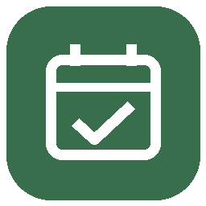
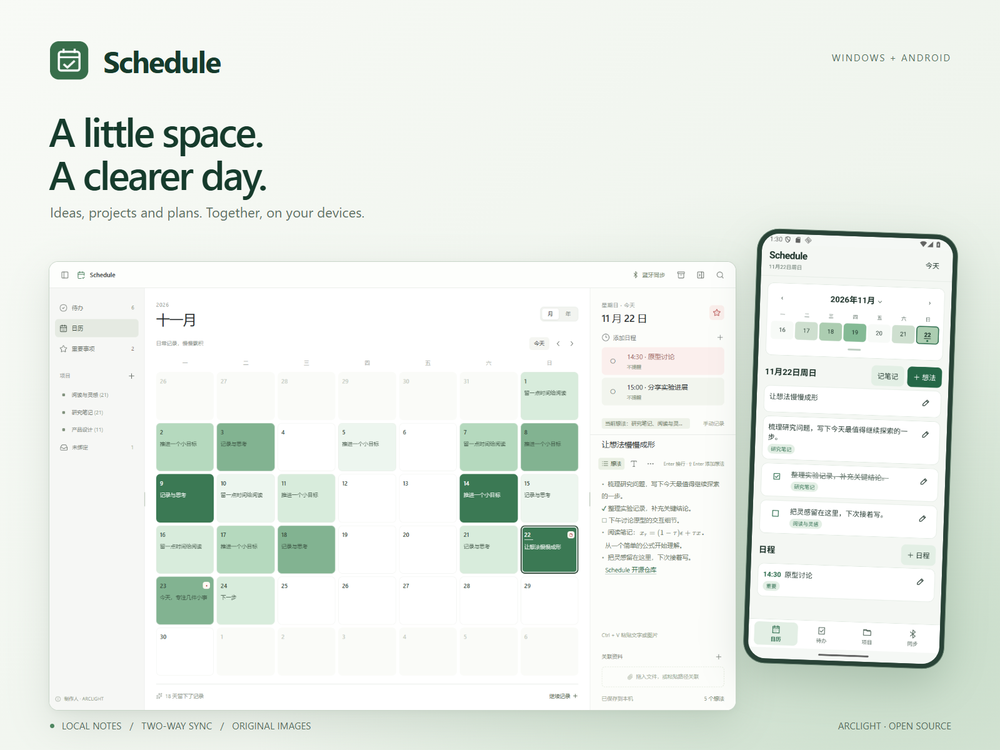
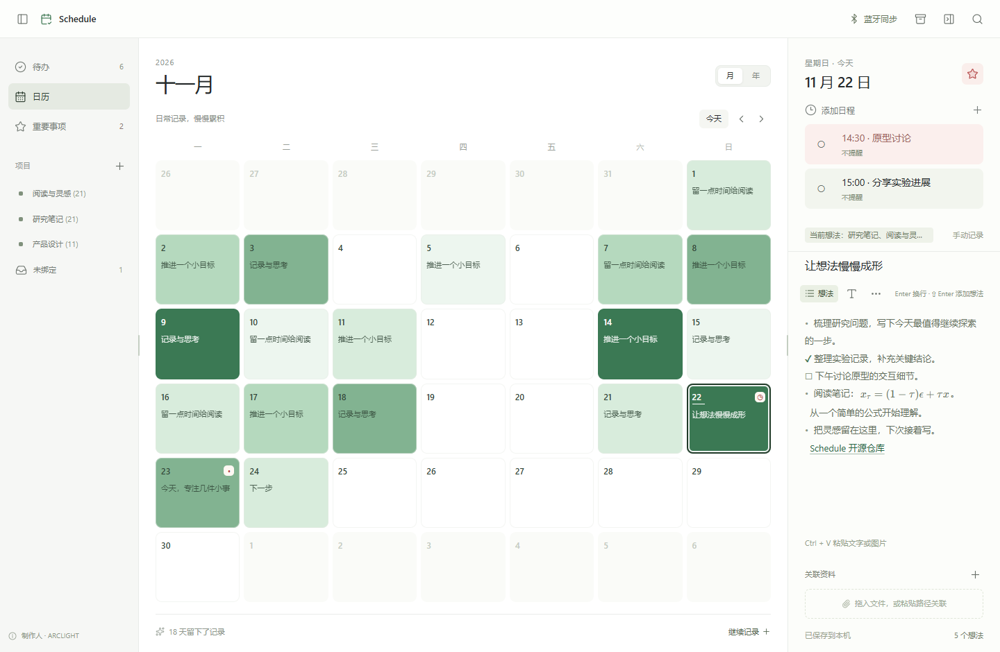
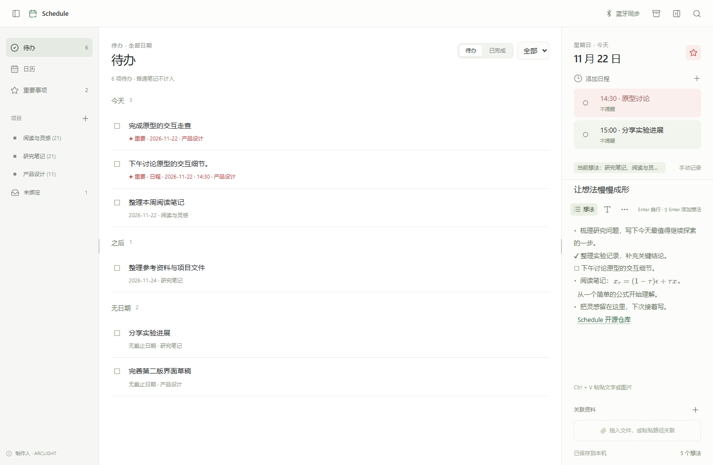
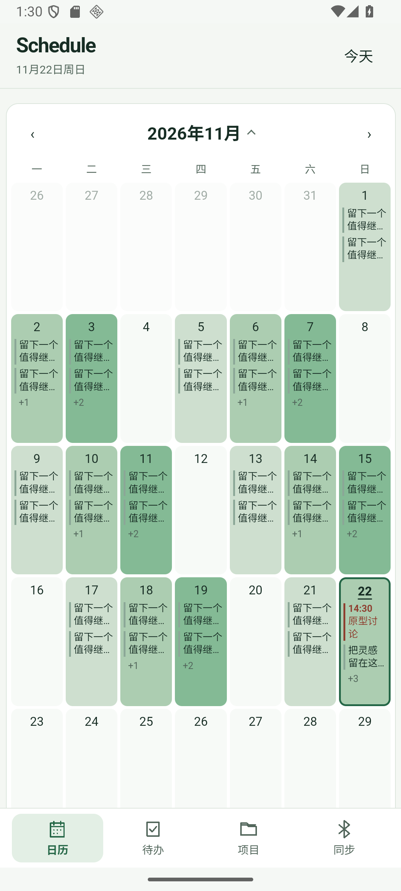

<p align="center"></p>
<h1 align="center">Schedule</h1>
<p align="center"><b>A little space for a clearer day.</b></p>
<p align="center">Windows × Android · Calendars, ideas and projects · Local storage, two-way sync</p>
<p align="center"><a href="README.md">简体中文</a> · <b>English</b></p>
<p align="center"><a href="https://github.com/ARC0127/Schedule/releases/tag/v0.0.14">Download</a> · <a href="docs/releases/0.0.14.md">Release notes</a> · <a href="https://arc0127.github.io/">ARCLIGHT</a> · <a href="LICENSE">MIT</a></p>



<p align="center"><sub>Both apps shown with synthetic demo data. No account required. Open the desktop app directly.</sub></p>

## Choose your device

| Windows 0.0.14 | Android 1.1.13 | Desktop + phone |
| :--- | :--- | :--- |
| [**Download Windows ZIP**](https://github.com/ARC0127/Schedule/releases/download/v0.0.14/Schedule-0.0.14-windows-x64.zip) | [**Download Android APK**](https://github.com/ARC0127/Schedule/releases/download/v0.0.14/Schedule.Android-1.1.13.apk) | [**Download both**](https://github.com/ARC0127/Schedule/releases/download/v0.0.14/Schedule-Windows-0.0.14-Android-1.1.13.zip) |
| Extract the entire folder and open `Journal.exe` | Install over your existing app to keep its data | Both apps and installation instructions |

Windows requires Windows 10/11 x64, .NET Framework 4.8 and [WebView2 Runtime](https://developer.microsoft.com/microsoft-edge/webview2/). Android requires 8.0 or later. The Windows executable is unsigned and may show an unknown-publisher prompt. Python and Node.js are not required to use the apps.

> **Upgrading:** Quit Windows Schedule from the tray before replacing its program files. Keep `%USERPROFILE%\.schedule`. Install the same-signed Android APK over the current app; **do not uninstall or clear its data**. Update both devices for batched original-image transfer.

## Capture a thought. Give it room to grow.

| See your days | Follow your ideas | Keep both devices in step |
| :--- | :--- | :--- |
| Green calendar cells reflect idea counts. Red marks highlight important items. Double-click a date to expand the day. | Write inside projects, edit in place, indent with Tab, format text and render math offline. Paste originals and click to preview them. | Merge notes, ideas, projects, originals and events in both directions. Review conflicting edits on your desktop. |

On Windows, connect local folders, drop files, resize your sidebar and editor, and preview today from a floating desktop icon or the tray. Codex and Claude Code share the same local read/write interface.

## New: quieter notifications, hourly sync

- **Quieter notifications:** the phone shows a fixed background-service notice. Progress and errors stay on the Sync page. Legacy two-hour settings migrate once to one hour, retaining pairing and paused state.
- **Update in the app:** read stable GitHub release notes, then download and verify the package. Windows exits and restarts; Android asks for installation confirmation.
- **Sync every hour:** select the paired device and enable sync once. Reconnection and saved changes also trigger attempts. Keep Windows in the tray; Android's sync page can be closed.
- **Keep conflict review:** independent additions merge automatically. Concurrent edits pause record changes for desktop confirmation.
- **Keep original images:** transfer missing originals in checked chunks, without recompression.

Older versions need one manual in-place upgrade to gain the updater. Package verification, Windows recovery after copy failures, and Android emulator upgrade data retention have been tested. **The reported physical Bluetooth error 10022 remains unresolved.** OTA uses each device's internet connection independently of Bluetooth sync. See the [release notes](docs/releases/0.0.14.md).

<details>
<summary><b>See the desktop calendar, tasks and expanded Android month</b></summary>



<p align="center"></p>

</details>

## Your first sync

Windows **0.0.14** / Android **1.1.13** add in-app updates. Click the download icon in the Windows toolbar, or open **Sync → Software updates** on Android, to check the latest stable GitHub release, read its notes and download an update. Downloads are checked before installation. Android also verifies the app signature and requires system installation confirmation. Older versions need one manual in-place upgrade to gain this entry. See the [release notes](docs/releases/0.0.14.md).

Both apps support background automatic sync. Select and enable the paired device once on each side. Sync defaults to every **hour**, runs once after reconnecting, and sends saved changes after an idle period. Windows offers 1/2/4/8-hour intervals. The phone's sync page can be closed; its background notification offers Pause. Unsaved drafts and pending conflicts defer synchronization. Keep Windows Schedule running, including in the tray. System background restrictions may delay execution.

Automatic sync uses existing connections without starting a phone hotspot or switching Windows Wi-Fi. Manual sync retains hotspot acceleration. Originals still transfer incrementally in batches. After upgrading, select the PC on Android and start the background listener, granting Nearby devices and notification permissions. Allow Schedule background autostart if HyperOS restricts it.

1. Pair the phone and PC in system Bluetooth settings.
2. On Android, open Schedule → Sync, select the PC and enable background sync. Grant required permissions and optionally approve “Allow background reconnection” once.
3. On Windows, open Bluetooth sync at the top right, select the phone and enable automatic sync or start a manual transfer. The phone's sync page can be closed.

The temporary hotspot does not share internet access. The PC may temporarily switch Wi-Fi and attempts to restore its previous connection afterward. Manual transfers are initiated by you; enabled automatic transfers run in the background. No cloud account is involved.

<details>
<summary><b>Everyday controls and shortcuts</b></summary>

## Everyday controls

| Action | How |
| --- | --- |
| Write for a day | Select a date and type in the editor on the right; clicking a muted adjacent-month date switches to that month and opens the selected day |
| Expand a day | Double-click a date to use both the calendar and editor area; use the back arrow or Esc to return. Single-click still selects the day |
| View important days | Open Important in the sidebar to list starred dates across all months. Click a row to expand that day; the back arrow or Esc returns to the list |
| Add an idea | **Shift+Enter**; **Enter** only adds a line |
| Structure your notes | **Tab** indents the current line; **Shift+Tab** outdents it. Select multiple lines to adjust them together. Undo and redo are supported |
| Edit in place | Double-click idea text in a project or the unbound overview to edit it where it is, with automatic saving. Click “完成编辑” (Finish editing) or press Esc to finish. The original date and project bindings stay intact |
| View original images | Click an image in a record or project to preview it inside the app. The image fits the window initially; use the wheel to zoom and drag to pan. Click outside the image or press Esc to close. Received image bytes are preserved without resizing or recompression; the per-image limit is 12 MB |
| Two-way Bluetooth sync | Pair in system settings, select each device once in Schedule, and enable automatic sync. Android offers one-time background reconnection approval; its sync page can be closed. Manual sync remains available on Windows. Use the existing Schedule shortcut |
| Choose projects | New ideas start unbound. Inside an idea, the picker immediately adds or removes bindings. Outside an idea, a manual selection applies only to the next idea and clears when changing dates, views or restarting. Writing in a project overview still binds to that project |
| Edit a project | Right-click its sidebar name to change the name or linked local folder. F2 or Shift+F10 works when the project is focused. Existing idea bindings are preserved |
| Project counts and order | Parentheses show each project's total ideas. Projects sort by unfinished idea count, keeping their original order on ties. Ordinary notes count as unfinished ideas without becoming todos |
| Write inside a project | Click the project overview's writing area. Ideas save automatically to today and bind to that project. Enter adds a line, Shift+Enter starts the next idea, and pasted images work inline. The unbound view supports the same flow |
| Mark complete | Place the caret inside an idea and **tap Ctrl alone** to complete it; tap again to return it to Todo. Ordinary notes can also be completed directly; Ctrl+C/V do not trigger completion |
| Insert an image | **Ctrl+V** in the editor |
| Format text | Select text to reveal formatting, or use the type icon to open it for future typing. Supports size, bold, italic, underline, color and clear formatting; **Ctrl+B / I / U** toggle bold / italic / underline |
| Write math | Use `\(...\)`, `\[...\]`, or `$$...$$`; focus the editor to edit TeX and leave it to see rendered equations, also shown in project overviews |
| Add an event | Use the clock / add-event control beneath the date |
| Idea actions | Place the caret in an idea and open **…** to select ordinary note / todo / completed, manage projects, importance and deadlines, link a schedule or delete the idea |
| Todo overview | Switch between pending and completed, and filter all / ordinary / important / scheduled tasks. Pending items are grouped by overdue, today, later and no date, with important items first within each group. Ordinary notes stay out of the list |
| Undo an action | Deleting an idea, changing its projects or toggling idea/event completion offers Undo for 10 seconds. Conflicting later edits are never overwritten; text editing still supports Ctrl+Z |
| Resume browsing | Project and search views remember their own page and scroll position. Sidebar width, visibility and the expanded-day layout are saved across restarts |
| Global search | Search text, projects, events and resources across all dates; open a result to reach its idea |
| Backups and exports | Open Data and backups using the archive icon in the top bar; preview differences before confirming a restore |
| Float on the desktop | Use the floating-icon control in the top bar; hover to preview today and click to restore |
| Tray and exit | Closing the main window sends it to the tray; use Exit in the tray menu to stop the app |
| Resize the sidebar | Drag the divider between the sidebar and content |
| Resize the writing area | Drag the divider at the left edge of the right editor; moving left widens it. Double-click to reset, or use arrow keys. The width is saved; expanded days still use the full area |

HTTP/HTTPS URLs, Markdown web links and Windows paths are recognized in both the editor and overviews. **Ctrl+click** opens a link while editing; after leaving the editor, a normal click opens it. Markdown links retain their source while editing and display their label while reading. Quote paths containing spaces. The daily resources section belongs to the date record and is shared across that day’s project views.

Pasting multiline text or equations keeps them in the current idea, including blank lines. Use Shift+Enter to add the next idea. Math renders offline; saving and copying retain the original TeX source.

New ideas start as ordinary notes. Mark one as a task to add importance or a linked schedule. Events can link to ideas from any date and follow that idea's completion; Todo shows one item for the idea and its linked events. Completing it from the calendar, project or event synchronizes the other views and cancels linked reminders. Converting it back to a note clears its deadline and detaches events, retaining them as standalone events. Existing checked ideas migrate to completed tasks; existing task flags and deadlines remain todos.

Text styles persist with each record and appear in project overviews and expanded day views. Copying within the app preserves styles, while plain-text copying retains the source text. These features are included in the v0.0.14 Windows download.

The desktop app opens today's date on startup. Midnight, tray restoration, and wake-up refresh the current day. An idle view of today follows the new day; active editing and historical-date browsing stay on their selected date. The Today button always reads the current system date.

Moving the window between monitors with different scaling settings redraws text and controls at the current monitor's DPI. The floating icon and today preview follow the monitor's scale as well.


</details>

## Your data stays on your computer

Updated apps merge notes, ideas, projects, original images and all events in both directions, including previously phone-only events. Stable IDs and a shared baseline distinguish updates, deletions and concurrent edits. Disconnects can be retried without duplicate records. Conflicts pause record changes for explicit desktop review before another sync. Linked and legacy events remain protected. Original image bytes travel in checked chunks without resizing or recompression. With both apps updated, originals transfer separately in 192 KiB chunks without a fixed aggregate quota. Metadata is limited to 100 MiB and each synced original to 64 MiB, subject to available disk space. Legacy peers retain the old whole-payload limits.

After system pairing, enable automatic sync on both devices for background connection attempts. For manual sync, start the phone listener and initiate the transfer on Windows. Older phones retain the shared-event protocol and show its limited scope. Local folder paths and Android document grants stay on their device. The updated Android app supports complete ZIP backup/restore including original images, with metadata recovery copies before synchronization and immutable original files retained separately. Do not uninstall or clear phone data. Android manual ZIP backups retain their existing 256 MiB total limit; sync recovery uses a separate metadata path.

Data is stored in `%USERPROFILE%\.schedule\journal.json`, including journal text, ideas, project bindings, image references, events, and floating-window position. New and received originals live in the adjacent `images` directory; older embedded originals remain compatible. Linked files remain at their original paths. Saves use a temporary file and atomic replacement; `.bak` holds the preceding version.

On first upgrade, legacy AppData and MSIX package-cache journals are backed up under `legacy-backups` before importing the populated copy. Different populated histories produce a visible conflict instead of an overwrite. Original files remain untouched; an existing new journal is never reimported. The new location avoids AppData redirection splitting desktop and Codex launches.

**Back up:** Exit from the tray, then copy the entire `%USERPROFILE%\.schedule` folder.

The Data and backups dialog also provides automatic daily snapshots (up to 30), retained manual snapshots and previews before restoring. Restore replaces all journal data, projects, images and events after preserving the current version. Windows reminders are reconciled after restore and still depend on notification permissions.

A complete ZIP contains the full JSON store, embedded images and referenced original files for import on another computer. Linked external files are referenced by path, not copied. Markdown ZIPs contain dated documents, events, completion, projects, deadlines and image files for reading. Use the complete backup to retain text formatting and internal IDs exactly. Importing a `.md` file appends it to the selected day, recognizes bullets/task checkboxes and loads local images referenced within its directory.

## Codex and Claude Code

Both use the same Windows CLI, without localhost or an additional runtime. `Schedule.Cli.exe` starts a tray process when needed and reads current GUI content. Writes require the `revision` returned by a read; stale revisions are rejected.

From the new application directory, install the skill for both assistants:

```powershell
powershell -NoProfile -File .\Install-AssistantSkills.ps1 -AppDirectory . -Target Both
```

Existing skills with the same name are preserved unless you explicitly use `-Force`, which first backs them up. Invoke `$schedule-local` in Codex or `/schedule-local` in Claude Code. You can also run `Schedule.Cli.exe --request request.json` with a UTF-8 JSON request, such as `{"op":"get_day","date":"2026-10-01"}`. See the [API reference](integrations/schedule-local/references/api.md). WSL sessions need Windows PowerShell access to this Windows executable.

**Upgrade:** Exit and back up first, then extract the new package over the existing program folder. Keeping the executable location and data folder preserves existing shortcuts and Windows notification identity. Legacy `points` / `newPointProjects` fields migrate to `ideas` / `newIdeaProjects`, retaining IDs, text, project bindings, and completion state.

## Build from source

Android source and build instructions are in [mobile/](mobile/README.md). Production signing keys are not included. A self-signed APK cannot update the official signed app.


On Windows, install Python 3.10+ and run:

```powershell
py -3 scripts/build.py
.\dist\Schedule\Journal.exe
```

The first build downloads pinned NuGet dependencies and uses the .NET Framework compiler included with Windows. Rust and the .NET SDK are not required. To create the distribution archive:

```powershell
py -3 scripts/package_release.py
```

The output is `dist/Schedule-0.0.14-windows-x64.zip`. It includes the app, both READMEs, the home screenshot, licenses, and the notes for this release.

Development tests also require Node.js and npm:

```powershell
npm ci
npm test
npm run test:native
npm run test:overview
npm run test:restart
npm run test:math
npm run test:calendar
npm run test:day-view
npm run test:important
npm run test:core
npm run test:cli
npm run test:usability
npm run test:tasks
npm run test:project-bindings
npm run test:project-compose
npm run test:editor-width
npm run test:editor-links-dpi
npm run test:math-svg
py -3 scripts/test_native_models.py
```

Native tests require a desktop session and WebView2, and set an isolated data directory before process startup. CI runs model tests and a Windows build. A version tag prepares a draft release using the [versioned notes](docs/releases/0.0.14.md). The same-signed Android APK and combined bundle are attached before publication.

Each document load reads the current file before enabling editing. Failed reads block editing, stale saves reject external file changes, and unchanged saves preserve the previous backup.

## Current scope

Windows currently has a Chinese interface; Android supports Chinese and English. Storage remains single-user JSON. Assistants communicate with the desktop process through the local CLI; remote network writes and direct edits to the live journal file are unsupported. Markdown is a readable export, while complete backups preserve the full data model. Windows notification settings, Do Not Disturb, shutdown and sleep can affect reminder delivery.

## Creator and license

Made by [**ARCLIGHT**](https://arc0127.github.io/) and released under the [MIT License](LICENSE). Report problems through [Issues](https://github.com/ARC0127/Schedule/issues).

[Architecture and data model (Chinese)](docs/architecture.md) · [Third-party notices](THIRD_PARTY_NOTICES.md) · [v0.0.14 release notes](docs/releases/0.0.14.md)
