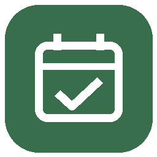
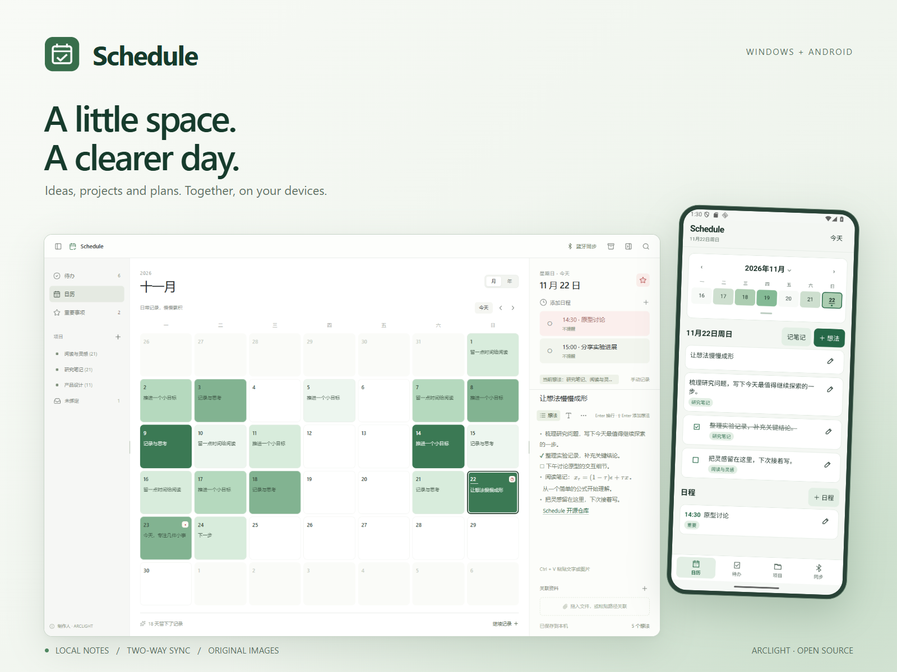
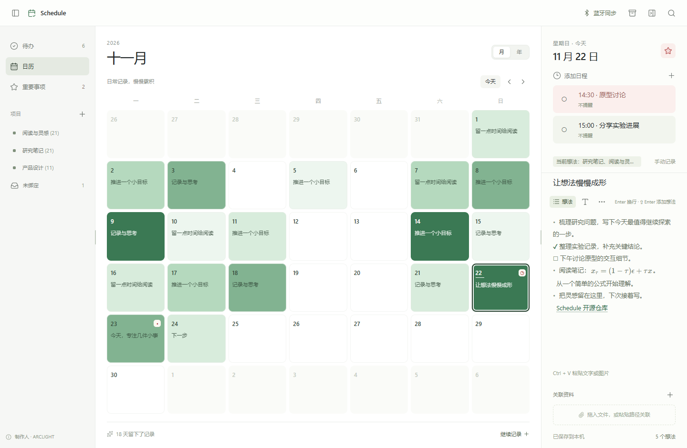
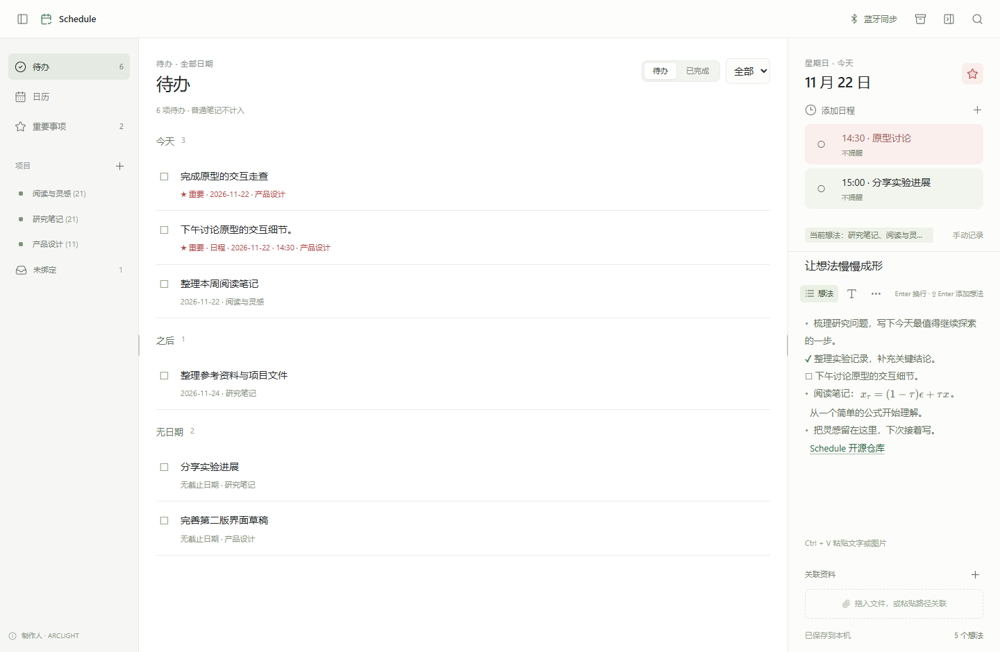
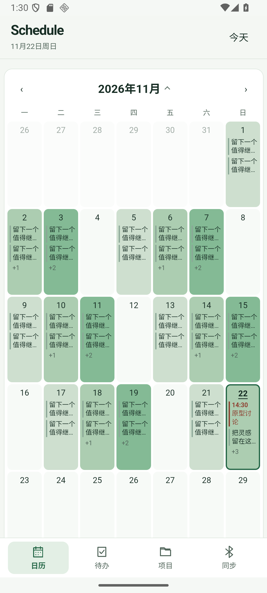

<p align="center"></p>
<h1 align="center">Schedule</h1>
<p align="center"><b>让每天的想法，都有地方安放。</b></p>
<p align="center">Windows × Android · 日历、想法与项目 · 本地保存，双向同步</p>
<p align="center"><b>简体中文</b> · <a href="README.en.md">English</a></p>
<p align="center"><a href="https://github.com/ARC0127/Schedule/releases/tag/v0.0.14">下载最新版</a> · <a href="docs/releases/0.0.14.md">版本说明</a> · <a href="https://arc0127.github.io/">ARCLIGHT</a> · <a href="LICENSE">MIT</a></p>



<p align="center"><sub>两端应用使用演示数据展示。无需账号，桌面版直接打开。</sub></p>

## 选择你的设备

| Windows 0.0.14 | Android 1.1.13 | 电脑 + 手机 |
| :--- | :--- | :--- |
| [**下载 Windows ZIP**](https://github.com/ARC0127/Schedule/releases/download/v0.0.14/Schedule-0.0.14-windows-x64.zip) | [**下载 Android APK**](https://github.com/ARC0127/Schedule/releases/download/v0.0.14/Schedule.Android-1.1.13.apk) | [**下载合并包**](https://github.com/ARC0127/Schedule/releases/download/v0.0.14/Schedule-Windows-0.0.14-Android-1.1.13.zip) |
| 解压整个文件夹，打开 `Journal.exe` | 在原应用上覆盖安装，保留已有记录 | 两端应用与安装说明，一次下载 |

Windows 需要 Windows 10/11 x64、.NET Framework 4.8 和 [WebView2 Runtime](https://developer.microsoft.com/microsoft-edge/webview2/)。Android 支持 8.0 及以上。Windows 程序暂未签名，系统可能提示未知发布者。运行软件不需要 Python 或 Node.js。

> **升级时**：Windows 从托盘退出后覆盖原程序目录，保留 `%USERPROFILE%\.schedule` 数据目录。Android 直接覆盖安装同签名 APK，**不要卸载或清空数据**。两端都更新后即可使用新的原图分批传输。

## 记录、整理，然后继续

| 看见每天的积累 | 给思路留足空间 | 两台设备，一份安排 |
| :--- | :--- | :--- |
| 日历按想法数量呈现绿色深浅，重要事项用红色标记。双击日期展开完整一天。 | 项目内直接写作、原位编辑、Tab 缩进、文字样式和离线公式。粘贴原图，单击看大图。 | 笔记、想法、项目、原图和日程双向合并。同一项两边都改了，在电脑确认保留哪个版本。 |

电脑端还可以关联本地文件夹、拖入文件、调整侧栏与编辑区宽度。托盘与桌面悬浮入口让当天安排随时可见。Codex 和 Claude Code 共用同一套本地读写接口。

## 这次更新：安静同步，每小时一次

- **通知更简洁**：手机后台通知固定显示服务已开启，进度和失败详情留在同步页。升级时旧的 2 小时设置一次性改为 1 小时，暂停状态和配对信息保留。
- **应用内更新**：查看 GitHub 正式版本及说明，下载校验后安装。Windows 自动退出并重启，Android 由系统确认安装。
- **每小时同步**：首次选择配对设备并启用后，恢复连接时同步一次，也会在保存改动后空闲时尝试同步。电脑留在托盘即可，手机不必一直打开同步页。
- **保留冲突确认**：独立新增自动合并，同一项两端都修改时暂停提交，由电脑确认。
- **继续传原图**：按文件分块传输，只补传缺少的原图，不重新压缩图片。

旧版本需先手动覆盖安装一次，之后即可使用更新入口。已验证更新包校验、Windows 文件替换失败恢复，以及 Android 模拟器覆盖升级后的记录和原图保留。**已报告的实机蓝牙错误 10022 尚未确认解决**，OTA 使用各设备的互联网连接，不依赖两端蓝牙同步。详情见 [版本说明](docs/releases/0.0.14.md)。

<details>
<summary><b>查看电脑日历、待办与手机展开月历</b></summary>



<p align="center"></p>

</details>

## 第一次同步

Windows **0.0.14** / Android **1.1.13** 加入应用内更新。Windows 点击顶部下载图标，Android 打开「同步 → 软件更新」，检查 GitHub 最新正式版本、查看说明并下载安装。安装前校验文件完整性，安卓还会核对应用签名并由系统确认安装。旧版本需手动覆盖安装一次才能获得更新入口。详见 [版本说明](docs/releases/0.0.14.md)。

两端支持后台自动同步。两端首次选择已配对设备并启用后，默认每 **1 小时**尝试，恢复连接后同步一次，已保存改动会在空闲后同步。电脑端可改为 1／2／4／8 小时。手机不必一直停在同步页，通知栏可以暂停；有未保存草稿或待确认冲突时延后。电脑须保持运行，托盘即可。系统后台限制可能推迟执行。

自动同步只使用已有网络，不开启临时热点、不切换电脑 Wi-Fi；手动同步保留热点加速。图片继续按原图增量分批传输。首次升级后需在手机选择电脑并启动后台服务，允许附近设备及通知权限。HyperOS 若限制后台运行，请允许 Schedule 后台自启动。

1. 在系统蓝牙设置中配对手机与电脑。
2. 手机打开 Schedule → 同步，选择电脑并开启后台自动同步，允许所需权限；可一次性授权“允许后台自动连接”。
3. 电脑点击右上角“蓝牙同步”，选择手机，开启自动同步；可手动点“双向同步”。手机无需停留在同步页。

临时热点不共享互联网，电脑可能暂时切换 Wi-Fi，结束后尝试恢复原连接。手动同步由你发起，不依赖云端账号。

<details>
<summary><b>日常操作与快捷键</b></summary>

## 最常用的操作

| 操作 | 用法 |
| --- | --- |
| 写当天记录 | 点击日历中的日期，在右侧输入；点击浅色的相邻月份日期，会自动切换月份并打开那天 |
| 展开当天安排 | 双击日期，合并日历与右侧记录区域；点击左箭头或按 Esc 返回，单击仍切换右侧记录 |
| 查看重要事项 | 点击左侧“重要事项”，按日期逐行查看全部星标记录；点击一行展开当天安排，左箭头或 Esc 返回列表 |
| 添加想法 | **Shift+Enter**；**Enter** 只换行 |
| 整理层级 | **Tab** 缩进当前行，**Shift+Tab** 退一级；选中多行可一起调整，支持撤销与重做 |
| 原地编辑 | 在项目或未绑定总览中双击想法正文，直接在原位置编辑并自动保存。点击“完成编辑”或按 Esc 退出，保留原日期和项目关联 |
| 查看原图 | 单击记录或项目中的图片，在应用内预览。自动适应窗口，支持滚轮缩放和拖动查看。点击图片外部的空白区域或按 Esc 关闭。图片按收到的原始字节保存，不缩小分辨率、不重新压缩；单张上限 12 MB |
| 蓝牙双向同步 | 系统配对后，两端在同步设置选择对方并启用自动同步。手机可一次性授权后台自动连接，无需保持同步页打开。也可在电脑手动同步。使用原有 Schedule 快捷方式 |
| 选择项目 | 新想法默认未绑定；光标位于想法内时可即时绑定、解绑或多选。光标不在想法内时，手动预选仅用于下一条想法，切换日期、页面或重启后清空；在项目总览内书写仍绑定当前项目 |
| 编辑项目 | 右键左侧项目名，直接修改名称或关联的本地文件夹；聚焦项目后也可按 F2 或 Shift+F10。已有想法关联保持不变 |
| 项目数量与排序 | 项目名后括号显示总想法数，默认按未完成想法数量降序排列，同数保持原顺序；普通笔记也计入未完成想法，但不会因此进入待办 |
| 在项目里直接写 | 点击项目总览空白输入区开始书写，自动保存到今天并绑定当前项目。Enter 换行，Shift+Enter 继续下一条，支持粘贴图片；“未绑定”页同样可直接写 |
| 标记完成 | 光标位于某个想法中，**单按 Ctrl** 标为已完成，再按回到待办；普通想法也可直接完成，Ctrl+C/V 不会误触 |
| 插入图片 | 在编辑区 **Ctrl+V** |
| 设置文字样式 | 选中文字显示格式栏，也可点击文字图标主动展开，为接下来的输入设置格式。支持字号、粗体、斜体、下划线、颜色和清除格式；**Ctrl+B / I / U** 切换粗体 / 斜体 / 下划线 |
| 写公式 | 使用 `\(...\)`、`\[...\]` 或 `$$...$$`；编辑时显示源码，移开焦点后显示公式，项目总览也会渲染 |
| 添加日程 | 点击日期下方的时钟或“添加日程”入口 |
| 想法操作 | 光标放在想法中，点击 **…**，选择普通想法／待办／已完成，设置项目、重要程度、截止日期或关联日程，也可删除想法 |
| 集中处理待办 | 左侧“待办”切换未完成与已完成，按全部／普通／重要／日程筛选。未完成事项按已逾期、今天、之后、无日期分组，组内重要事项优先；普通笔记不计入 |
| 撤销操作 | 删除想法、修改项目绑定、切换想法或日程完成状态后，提示中提供 10 秒“撤销”。之后的新修改不会被强行覆盖，正文仍支持 Ctrl+Z |
| 保留浏览位置 | 项目、搜索等视图分别记住分页和滚动位置，返回时继续查看；侧栏宽度、开合状态和当天展开状态随应用保存 |
| 全局搜索 | 点击顶栏搜索，跨日期查找正文、项目、日程与资料；点击结果打开对应想法 |
| 备份与导出 | 顶栏归档图标打开“数据与备份”；恢复前先预览差异，再确认替换 |
| 桌面悬浮 | 点击顶栏的悬浮入口按钮；靠近查看今天，点击回到主窗口 |
| 托盘与退出 | 关闭主窗口会收至托盘；在托盘菜单中选择退出才会结束程序 |
| 调整侧栏 | 拖动左侧栏与内容区之间的分隔线 |
| 调整右侧写作区 | 拖动右侧记录区左边的分隔线，向左拖动加宽；双击恢复默认，也支持左右方向键。宽度自动保存，展开当天时使用完整区域 |

HTTP/HTTPS 网址、Markdown 网页链接和 Windows 路径在编辑区与总览中都会识别。编辑时用 **Ctrl+单击** 打开，移开编辑焦点后可直接单击；Markdown 链接编辑时保留源码，阅读时显示链接文字。含空格的路径请用双引号括起。“当天资料”属于该日期的记录，由这一天的项目总览共享。

粘贴多行文字或公式不会自动拆分想法。换行与空行仍属于当前想法，使用 Shift+Enter 才添加下一个想法。公式在本机离线渲染，保存和复制保留原始 TeX。

新想法默认是普通笔记，手动设为待办后可标为重要或关联日程。日程设置可选择关联任意日期的想法，关联后完成状态跟随想法，在待办里只显示一项；从日程、项目或日历完成它，其他位置同步，关联提醒也取消。转回普通想法会清除截止日期并解除关联，日程保留为独立日程。旧版本已经打勾的想法归入已完成，有截止日期或待办标记的归入待办。

文字样式会随记录保存，并显示在项目总览和展开的当天页面中。应用内复制粘贴保留样式，纯文本复制保留正文。以上功能均已包含在 v0.0.14 Windows 下载包中。

桌面版启动时打开当天。跨过午夜、从托盘恢复或唤醒后会更新“今天”；停留在当天且未输入时自动进入新一天，正在编辑或浏览历史日期时保留当前日期。点击“今天”随时返回系统当前日期。

窗口在不同缩放比例的显示器之间移动时，会按当前屏幕 DPI 重新渲染文字和界面；悬浮图标与今日预览也随屏幕缩放。


</details>

## 你的数据，留在本机

新版两端通过蓝牙双向合并笔记、想法、项目、原始图片及全部日程，包括手机以前的本地日程。同步按稳定编号和上次共同版本合并，断线可重试。同一项两端都修改时暂停记录提交，在电脑逐项确认后继续同步。Windows 关联想法的日程仍由想法控制完成状态，旧格式日程在手机端只读。图片分块传输并校验内容，不缩放或重新压缩。两端更新后，原图按 192 KiB 分块独立传输，图片合计不设固定额度。文字元数据最多 100 MiB，单张同步原图最多 64 MiB，仍需足够磁盘空间。旧版手机使用原来的整包限制。

系统配对完成后，在两端启用自动同步即可后台尝试连接；未启用时由手机开启等待、电脑发起手动同步。旧版手机自动使用原有共享日程协议，并明确提示笔记与手机本地日程未同步。本地文件夹路径和 Android 文档授权不跨设备传递。Android 新版提供含原图的完整 ZIP 备份与恢复，同步前保留文字和日程的恢复副本，原图作为不可变文件保留，不再为每次同步把所有图片载入内存。无需卸载或清空手机数据。Android 手动 ZIP 备份仍有原有的 256 MiB 总量限制，新的同步恢复不使用该路径。

数据保存在 `%USERPROFILE%\.schedule\journal.json`，包含正文、想法、项目关系、图片索引、日程与悬浮位置。新增及同步收到的原图保存在同目录的 `images` 文件夹，旧版内嵌图片仍兼容。关联的文件仍留在原路径。保存采用临时文件和原子替换，`.bak` 保存上一版。界面每次加载都会重新读取文件，读取失败时禁止编辑。保存前检查文件是否已被修改，过期状态不会覆盖磁盘内容；未变化的保存不会轮换备份。

首次升级会自动检查旧 AppData 和 MSIX 包缓存中的日志，先备份至新目录的 `legacy-backups`，再迁入有内容的副本。若有多份不同的有效日志，会提示冲突而不覆盖。旧文件保留；新目录已有日志时不会重新导入。此位置避免 Codex 与桌面启动因 Windows AppData 重定向而读到不同数据。

**备份：** 从托盘退出程序，再复制整个 `%USERPROFILE%\.schedule` 文件夹。

也可在“数据与备份”中直接操作：保存前自动保留每日快照，最多保留 30 个每日快照；手动备份与恢复前备份一直保留。恢复会替换全部记录、项目、图片和日程，先显示差异并备份当前版本。Windows 通知仍受系统权限影响，恢复后会重新安排提醒。

完整 ZIP 备份包含原始 JSON、内嵌图片及独立原图文件，可在另一台电脑导入。关联文件仅保留路径，不复制外部文件。Markdown ZIP 按日期导出正文、日程、完成状态、项目、截止日期和图片，适合阅读；完整保留格式与内部 ID 请使用完整备份。导入 `.md` 会追加到当前日期，识别列表与任务勾选，并读取同目录内引用的本地图片。

## Codex 与 Claude Code

两者使用同一套 Windows 本地接口，无需 localhost 或额外运行时。`Schedule.Cli.exe` 会在必要时启动托盘进程，读取界面当前内容；写入需要读取结果里的 `revision`，过期版本会明确拒绝覆盖。

在新版程序目录运行以下命令即可安装两种助手的 skill（已有同名 skill 时会停止，避免覆盖）：

```powershell
powershell -NoProfile -File .\Install-AssistantSkills.ps1 -AppDirectory . -Target Both
```

Codex 可使用 `$schedule-local`，Claude Code 可使用 `/schedule-local`。也可以直接写 UTF-8 请求文件并运行 `Schedule.Cli.exe --request request.json`。例如 `{"op":"get_day","date":"2026-10-01"}`。参见 [API 操作与冲突处理](integrations/schedule-local/references/api.md)。WSL 会话需要通过 Windows PowerShell 调用这个 Windows 程序。

**升级：** 先退出并备份，将新版解压到原程序文件夹，覆盖程序文件。保留原安装位置与数据目录，可以继续使用已有快捷方式和 Windows 提醒身份。旧版 `points` / `newPointProjects` 字段会迁移为 `ideas` / `newIdeaProjects`，保留原 ID、正文、项目关系和完成状态。

## 从源码构建

Android 源码与构建说明位于 [mobile/](mobile/README.md)，生产签名私钥不在仓库中。自行签名的 APK 不能覆盖官方签名版本。


在 Windows 上安装 Python 3.10+，运行：

```powershell
py -3 scripts/build.py
.\dist\Schedule\Journal.exe
```

首次构建联网下载固定版本的 NuGet 依赖，使用 Windows 自带的 .NET Framework 编译器。无需 Rust 或 .NET SDK。生成正式压缩包：

```powershell
py -3 scripts/package_release.py
```

输出为 `dist/Schedule-0.0.14-windows-x64.zip`，包含程序、中英文 README、首页图、许可证及本版发布说明。

开发测试另需 Node.js 与 npm：

```powershell
npm ci
npm test
npm run test:native
npm run test:overview
npm run test:restart
npm run test:math
npm run test:calendar
npm run test:day-view
npm run test:important
npm run test:core
npm run test:cli
npm run test:usability
npm run test:tasks
npm run test:project-bindings
npm run test:project-compose
npm run test:editor-width
npm run test:editor-links-dpi
npm run test:math-svg
py -3 scripts/test_native_models.py
```

原生测试需要桌面会话和 WebView2，启动前设置独立数据目录。CI 执行状态迁移测试和 Windows 构建。版本标签触发 Windows 构建并创建草稿 Release，使用 [版本说明](docs/releases/0.0.14.md)。同签名 Android APK 与合并包上传后再公开发布。

## 当前边界

Windows 界面为中文，Android 支持中英文。数据使用单用户 JSON 存储。助手通过本地 CLI 与桌面进程通信，不支持远程网络写入或直接编辑运行中的日志文件。Markdown 是可读导出格式，完整恢复应使用备份包。Windows 通知设置、免打扰、关机或休眠可能影响提醒投递。

## 开源与制作

由 [**ARCLIGHT**](https://arc0127.github.io/) 制作，使用 [MIT 许可证](LICENSE)。欢迎通过 [Issues](https://github.com/ARC0127/Schedule/issues) 反馈问题。

[架构与数据说明](docs/architecture.md) · [第三方许可](THIRD_PARTY_NOTICES.md) · [v0.0.14 发布说明](docs/releases/0.0.14.md)
